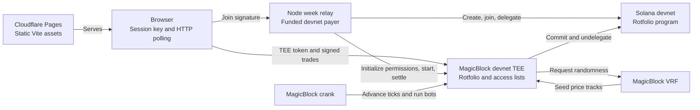

# Rotfolio

Buy low, earn your way into private island markets, and sell before your Rots expire in a two-minute trading game on Solana devnet.

[Play it](https://rotfolio.pages.dev)

Demo video: VIDEO_URL_TODO

## Who it's for

Rotfolio is for trading-game players who enjoy finding an edge. On a conventional public chain, every price and move is visible to every player, so there is no information edge. Rotfolio keeps island price tracks private with a MagicBlock Private Ephemeral Rollup. Owners can read their own tracks. Other players need a gate pass to read that island. At tick 13, all island tracks, player balances, and gate passes become public.

## How a week works

1. **Sunday buy.** Play now seats you with three house bots and 12,000 play coins each. Once the buy card appears, you have 30 seconds to buy up to 100 Rots once at your island’s Sunday price. Choose **Done buying** to open Monday early.
2. **AM and PM trading.** Monday through Saturday each have two price ticks. In turbo mode, the crank advances a tick every ten seconds. You can sell some or all of your Rots on your own island.
3. **Island gates.** Request a visit to a house island on the Archipelago screen. When the crank grants your pass, you pay the owner a 20-coin tip and can read its live price and sell there. You can use up to three passes per week.
4. **Rot Sunday.** At tick 13, any unsold Rots expire. The program makes every price track, player balance, and gate pass public, then publishes a scoreboard ranked by final coins. Settlement commits the result back to Solana devnet.

## MagicBlock features used

| Feature | How Rotfolio uses it |
| --- | --- |
| Private ER (TEE) access lists | Each owner can read their own island's prices. A gate pass adds its visitor to that island's access list. The program also requires a live pass for away sales. |
| VRF | The callback assigns one pattern per island and uses each pattern once, so every week has exactly one BigSpike island. |
| Crank | The crank advances the market clock, runs house bots, grants gates, and reveals the week at tick 13. |
| Commit and undelegate | Settlement commits the final state to Solana devnet and returns the delegated accounts to the base layer. |
| Gasless session keys and relay | The browser signs with a temporary session key, the relay sponsors base-layer setup, and players trade on the ER without funding a wallet. |

## Architecture



## Devnet evidence

[Rotfolio program](https://explorer.solana.com/address/9czd3zpazBa4fLBcNihWyKEgeKkZ4K8xEdoMWeY5Zj9b?cluster=devnet) · [M3 program upgrade](https://explorer.solana.com/tx/261yQSwTNAZyfLPQ4mP6axdt8KyGNNckUShqow5oqHfrUZwqJaQPTP7jEzSj1kfnjWniu4FGvvmvPqsSF81nFtK7?cluster=devnet) · [M3 verification notes](docs/devnet-evidence.md)

| Run | Week account | Delegation | VRF request | Settle transaction |
| --- | --- | --- | --- | --- |
| M3 run 1 | [Week](https://explorer.solana.com/address/39XFGEhTrMDrcRJpRMRuAACxALdLV6UqbWbRbScgFEs9?cluster=devnet) | [Solana devnet](https://explorer.solana.com/tx/aM8yaXm4bPap2LBL57T1WyAUdTCzwwNHwsVuj5f9JNY59jDfGw2snviC6TRPBmBN1LxL37HdFquX1rDVSfaujNp?cluster=devnet) | [TEE request](https://explorer.solana.com/tx/3Czuk2FqUcqpJCET9M2Q9KhSdKp9nspRV7ZD9Z2KbP4ipwjdq7o6ywYfgpEhTVrKUYFKo3quNMuhq285CTAiVqMm?cluster=custom&customUrl=https%3A%2F%2Fdevnet-tee.magicblock.app) | [TEE settle](https://explorer.solana.com/tx/iaGwWTTKKsviDJAtmiPhtA2AJcQrfUdrsL9hUcmWEgmV8jR37uhbKyfPB2WsA2GwCodax45iHjiuBeada9Hf243?cluster=custom&customUrl=https%3A%2F%2Fdevnet-tee.magicblock.app) |
| M3 run 2 | [Week](https://explorer.solana.com/address/9w14NSQtaVt98mWWeBkgViAdVhiQSUHoiSMKfcZ5tKdK?cluster=devnet) | [Solana devnet](https://explorer.solana.com/tx/nKfQqDCgCnK8eSgFKzqASnvqpZvCxSuSo22aKaMWtUNtaSjz2SSqsu8ghoGhL6KMj3NgbjKzr4UMB513GygaiqL?cluster=devnet) | [TEE request](https://explorer.solana.com/tx/4zMV9LjASvYwX6WyGjLyUurjJpr9PQvTuBTnbdPkTv9tW5hQbX3cs41GRbUKxpCXvzS2F6omGHxgUZEin7PtSQXi?cluster=custom&customUrl=https%3A%2F%2Fdevnet-tee.magicblock.app) | [TEE settle](https://explorer.solana.com/tx/2N1TYzKmNJDTqsD56isbgPPXmKasKJh9x8LwXiyQia2RhfJRQ6uiXxFW3GGah5jkQikd7rNGTY4aJxUxvzhjgvTw?cluster=custom&customUrl=https%3A%2F%2Fdevnet-tee.magicblock.app) |
| M5 run 1 | [Week](https://explorer.solana.com/address/CGKsSxEUs1tBQWZ8Cji2e1cdXS2RdsQfcc5rmHvfPUPL?cluster=devnet) | [Solana devnet](https://explorer.solana.com/tx/53U4a9D2gCXiAtYSYGQ8QCZyqER526WBC1tFneUqJLk7Fi6cnzv6jNWJHkbEUM1koau5SALRM3tFb88KVXfRhsm4?cluster=devnet) | [TEE request](https://explorer.solana.com/tx/2cPH3cAuyUw7J7mgMyJf7aKLDbFPkPFK9eQnD2vxPAKPQdubHHsgz7pTA3TJDMkJDmiPVkfLcJUC9yutkQBDcJTD?cluster=custom&customUrl=https%3A%2F%2Fdevnet-tee.magicblock.app) | [TEE settle](https://explorer.solana.com/tx/Kj2RkBrYG7kws3ccqcePjGqFYHdEc55bgVCxdqPznwSwTFWs9ELBoYRqVLaYHoX1soKK5QnwEtfRFzwBbyNeabR?cluster=custom&customUrl=https%3A%2F%2Fdevnet-tee.magicblock.app) |
| M5 run 2 | [Week](https://explorer.solana.com/address/7VH5x1MqQuqXVPDZm45jYPiansRXgNo1vQgw3piR7Fxc?cluster=devnet) | [Solana devnet](https://explorer.solana.com/tx/szhEpjwPFTisReVxSVNtPuRJ9wfwbf7yz6NJ4pw9GT6g27nEame6z1JYr6t3gpbAnKgWKJQxmk1kAVcwXETyoRU?cluster=devnet) | [TEE request](https://explorer.solana.com/tx/2vgysmvsSR2HfWfiUio85tpsfFAadGVtLBnTLeEfjBUAZ2qQzViaAzCYvNztrmYvUppFmurVyPJJE1gM9nV4tpj1?cluster=custom&customUrl=https%3A%2F%2Fdevnet-tee.magicblock.app) | [TEE settle](https://explorer.solana.com/tx/4JEKTNE1sAY3Yj5Kb2DnWekmNDmQfxCnmwEgxkA6nCCNicCYpnvPwCXr6wvNrLX1vYSJmtd7MD8yDACJTEjzcmZE?cluster=custom&customUrl=https%3A%2F%2Fdevnet-tee.magicblock.app) |
| M5 run 3 | [Week](https://explorer.solana.com/address/AEPJBrCYRuiZmwHSF6psj7mJcV4jEpyjfcAzA2sNZjUM?cluster=devnet) | [Solana devnet](https://explorer.solana.com/tx/5BkWxUbBQH18t95rBaw3gfrZEVR8c9DJ3y4vghknVGgrW64J3kNfCGT9kdCgoyidhUCpf8tLHapfwNgHSxfssFAF?cluster=devnet) | [TEE request](https://explorer.solana.com/tx/5cydVascoVjPWgC1egkxM2uyQPZBu9dVwyW7LNspve84SBL1cpmWohjjmdBQfJBKnPCuTEve8U7FJ1BMWvD4mH2y?cluster=custom&customUrl=https%3A%2F%2Fdevnet-tee.magicblock.app) | [TEE settle](https://explorer.solana.com/tx/2KbrF2inUXH7tzUCXfXUvUvoaM8E2YLJJj682MuU1sgi8DWgsRXBzQh5eUV6n4hEjGUkMRyjfjcBmxedTf7LNSpb?cluster=custom&customUrl=https%3A%2F%2Fdevnet-tee.magicblock.app) |

The M3 tests verified private reads, trading limits, bot activity, and return of all nine delegated accounts. Each M5 run reached tick 13, revealed one BigSpike island, and verified three crank-driven bot sales from the public final balances.

## Limits

- This is a devnet game with 12,000 starting play coins per seat. Coins and Rots have no cash value. There are no real-money stakes or payouts.
- Session keys are easy to create. Any future real-money version would need a way to limit one person from creating many identities and collecting multiple stakes.
- The deployed program enforces the three house bots’ buys, sales, and gate grants inside the crank. Their accounts are sealed to RPC readers during play. The final demo verifies the sales after the public reveal.
- The static UI uses a separate always-running week relay for base-layer setup and settlement. The relay holds active jobs in memory, so restarting it interrupts in-flight setup and settlement. Each new week spends devnet SOL from the relay payer.

## Run locally

From the repo root, use Node.js 20 or newer and a funded devnet payer at `keys/deployer.json`. Vite starts the relay on the same local origin in development.

```sh
npm ci
npm --prefix app run dev
```

For a scripted devnet week with a terminal timeline and Explorer links, run `npm run demo:week`.

## Tests

| Command | Coverage |
| --- | --- |
| `cargo test -p rotfolio --lib` | Pricing and calendar unit tests |
| `npm test` | Client unit tests |
| `npx ts-mocha -t 300000 tests/week.ts` | Full devnet integration suite. Requires a funded devnet payer at `keys/deployer.json` and spends devnet SOL. |

## Deploy the static UI to Cloudflare Pages

Run these steps from the repo root. The Pages upload consists of the static files in `app/dist`. The Node relay runs separately with its own funded devnet payer file.

| Setting | Where it is used | Purpose |
| --- | --- | --- |
| `VITE_WEEK_API_ORIGIN` | Local UI build | Public HTTPS origin of the relay, with no path. This value is public. |
| `ROTFOLIO_UI_ORIGIN` | Relay process | Exact HTTPS origin of the Pages UI, with no path. |
| `ROTFOLIO_DEVNET_PAYER_PATH` | Relay process, optional | Path to a dedicated devnet payer keypair. Defaults to `keys/deployer.json`, the devnet program upgrade authority. |
| `ROTFOLIO_RELAY_PORT` | Relay process, optional | Loopback port. Defaults to `8787`. |
| `ROTFOLIO_RELAY_WEEKS_PER_HOUR` | Relay process, optional | Global new-week limit in a rolling hour. Defaults to `30`. |
| `ROTFOLIO_RELAY_WEEKS_PER_IP_HOUR` | Relay process, optional | New-week limit per client IP in a rolling hour. Defaults to `4`. |
| `ROTFOLIO_RELAY_MIN_SOL` | Relay process, optional | Minimum payer balance in devnet SOL before accepting a new week. Defaults to `0.5`. |
| `ROTFOLIO_TRUST_PROXY` | Relay process, optional | Set to `1` to use the first `X-Forwarded-For` entry if it is a valid IP. Defaults to the socket address. Enable it only behind a proxy that controls that first entry. |

`POST /api/week/health` reports process availability and the remaining global hourly capacity. Settled jobs and jobs waiting for a retry expire after two hours.

1. Sign in to Wrangler and create a Direct Upload Pages project once. Use the production origin Cloudflare assigns to your project.

   ```sh
   npx wrangler login
   npx wrangler pages project create rotfolio --production-branch main
   ```

2. On the relay host, keep this process running. Use the Pages origin assigned in step 1. Route an HTTPS reverse proxy to its loopback port. For a temporary recording or demo, you can instead run `cloudflared tunnel --url http://127.0.0.1:8787` in a second terminal and use the printed HTTPS origin in step 3. A temporary tunnel URL changes if the tunnel restarts. Keep the payer file on the relay host. [Quick Tunnel documentation](https://developers.cloudflare.com/tunnel/get-started/quick-tunnels/)

   ```sh
   npm ci
   ROTFOLIO_UI_ORIGIN=https://rotfolio.pages.dev npm run relay:devnet
   ```

3. Build and upload. Replace `https://relay.example.com` with the relay’s HTTPS origin. If you chose another Pages project name, use it in both `wrangler.jsonc` and the deploy command. [Cloudflare Pages Direct Upload documentation](https://developers.cloudflare.com/pages/get-started/direct-upload/)

   ```sh
   VITE_WEEK_API_ORIGIN=https://relay.example.com npm --prefix app run build
   npx wrangler pages deploy app/dist --project-name rotfolio --branch main
   ```

4. Open the production URL and play a week to verify the UI and relay.

## Pinned versions

| Tool | Version |
| --- | --- |
| Rust | 1.99.1 stable |
| Agave CLI | 4.0.0 |
| SBF build helper and platform tools | 4.5.0 and v1.57 |
| Anchor CLI and Rust `anchor-lang` | 1.0.2 |
| MagicBlock Rust and npm SDKs | 0.18.0 |
| MagicBlock devnet TEE core | 1.1.1 |
| TypeScript Anchor client | 0.32.1 |
| Solana Web3.js | 1.99.0 in the lockfile, declared as ^1.98.0 |
| React and React DOM | 19.3.1 in the lockfile |
| Vite and TypeScript | 6.4.6 and 5.9.3 in the lockfile |
| Node.js | 20 or newer, tested with 24.12.0 |

## Build the program from a fresh clone

Install Rust, Agave CLI 4.0.0, and Anchor CLI 1.0.2 as listed in [Pinned versions](#pinned-versions). From the repository root, build the program and IDL.

```sh
anchor build
```

The deployed program's keypair is not in this repository. Build outputs go in `target/`.

## Credits

Inspired by a classic console island game's weekly crop market.

## License

[MIT](LICENSE)
